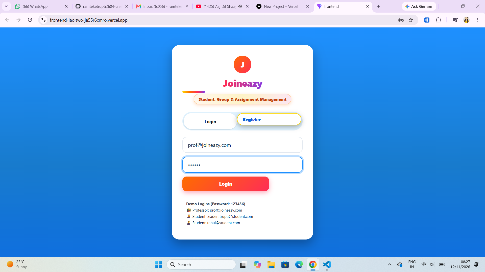
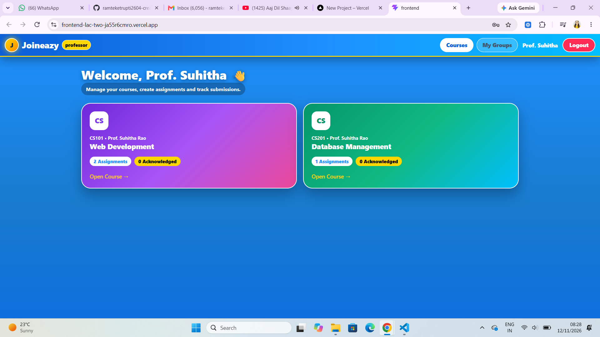
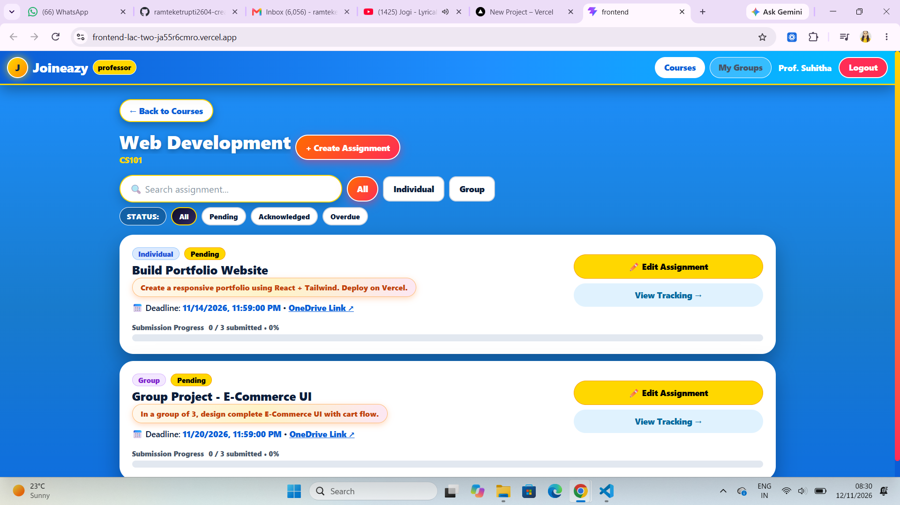

# Joineazy – Frontend Intern, Round 2

**Student, Group & Assignment Management: UI/UX Enhancement**

## 🔗 Live Links
- **Live Demo (Vercel):** https://frontend-lac-two-ja55r6cmro.vercel.app/
- **GitHub Repo:** https://github.com/ramteketrupti2604-creator/Joineazy-Round2
- **Demo Video:** [Paste Loom / Drive Link Here]

---

## ✨ What I Built

### 1. Authentication (Both Roles)
- Login / Register forms with validation and clear error messages.
- On Register, user picks role - **Student / Professor / Group Leader**.
- JWT-style session: simulated token stored in `localStorage`. Logout clears it. Protected pages need login.
- After login, each role goes to its own dashboard.

**Demo Logins:**
| Role | Email | Password |
| --- | --- | --- |
| Professor | prof@joineazy.com | 123456 |
| Group Leader | leader@joineazy.com | 123456 |
| Student | student@joineazy.com | student123 |

> You can also Register with any new email + password, it will save in localStorage.

### 2. Professor Flow
- **Dashboard:** Cards for courses they teach. Clicking a course opens its Assignments page.
- **Assignments Page:** Create, View assignments with fields:
    - Title, Description, Deadline (date + time), OneDrive Link, Submission Type (Individual / Group)
- **Tracking for each assignment:**
    - How many students / groups submitted out of total
    - Progress bar + summary counts
    - Drill-down list - who submitted, who hasn't

### 3. Student Flow
- **Dashboard:** Cards for enrolled courses this semester. Click opens Assignments page.
- **Assignments Page shows:** Name, Description, Deadline, OneDrive Link, Submission Type, Acknowledgement Status.
- **Individual Assignment:** Student acknowledges for self - `Yes, I have submitted` -> Confirm. Timestamp stored.
- **Group Assignment:** Only Group Leader can acknowledge. After that, every member sees `Acknowledged by [Leader] on [date and time]`.
- **No Group:** Shows message `You are not part of any group. Create or join one to submit this assignment.` + Create / Join button.

### 4. Groups (Keep it Simple)
- Student can create a group in a course (becomes Leader) or join existing group.
- Shows group members + who is Leader.

### 5. Progress & Polish
- Progress bars, checkmarks, badges for completion. Overdue highlighted in red.
- Toast confirmations, hover states, small transitions, loading / empty states.
- Fully responsive on Mobile, Tablet & Desktop - Desktop Sidebar + Mobile Bottom Nav.

---

## 🎨 Design Choices

- **Layout:** Sidebar + Topbar on desktop, Bottom Navigation + Top Header on mobile. This makes the app easy to use with one hand on mobile and gives more space for content on desktop.
- **Colors:** Joineazy brand identity - Blue gradient background (`#1E90FF` to `#0F6FDE`) for the Auth screen to keep focus on login, and Orange to Pink gradient for primary call-to-action buttons. White cards with soft shadows keep the content clean and readable.
- **Typography:** `Inter`, `Segoe UI` sans-serif. Bold headings for hierarchy, red color for overdue deadlines, and green for acknowledged / completed tasks for quick scanning.
- **Components:** Reusable cards, buttons, and inputs are used across both Professor and Student views, so the UI feels consistent and easy to learn.
- **UX Details:** Toast confirmation on every action, hover states, small transitions, and clear empty states with a button instead of a blank screen.
- **Data:** No real backend - Mock API using `localStorage`. All data persists in the browser, so login remains active even after refresh. This was allowed in the task.
- **Styling:** React + Tailwind CSS (`@import "tailwindcss"` in `index.css`) + Custom CSS. Tailwind utilities are used for layout, and custom CSS is used for Sidebar, Bottom Nav, Cards, and responsive breakpoints.

## 🛠️ Tech Stack
- React.js + Vite
- JavaScript (ES6+)
- Tailwind CSS + Custom CSS - Responsive (Mobile / Tablet / Desktop)
- localStorage - Mock API + JWT-style Session
- Vercel - Deployment

## 🚀 Setup Steps

```bash
# 1. Clone repo
git clone https://github.com/ramteketrupti2604-creator/Joineazy-Round2.git
cd Joineazy-Round2

# 2. Go to frontend
cd frontend

# 3. Install dependencies
npm install

# 4. Run locally
npm run dev
# Open http://localhost:5173

# 5. Build for production
npm run build
```

## 📁 Component Structure
Joineazy-Round2/
└── frontend/
    ├── index.html
    ├── package.json
    ├── package-lock.json
    ├── vite.config.js
    ├── .gitignore
    ├── .oxlintrc.json
    ├── README.md
    ├── public/
    │   ├── favicon.svg
    │   └── icons.svg
    └── src/
        ├── main.jsx          # Entry point, App render
        ├── App.jsx           # Routing, Protected Routes, All Pages
        │   ├── <AuthPage />      # Login / Register + Role Select
        │   ├── <Dashboard />    # Role-based Dashboard - Professor / Student
        │   ├── <GroupsPage />   # Create / Join Group, Members + Leader
        │   ├── <AssignmentsPage /> # Create, View, Acknowledge, Tracking
        │   └── <Toast />        # Confirmation Toast
        ├── App.css           # Component Styles - Cards, Buttons
        ├── index.css         # Tailwind + Global Styles + Responsive
        └── assets/           # Images, Icons
        ```

App.jsx Flow:
Login -> Check Role -> Professor Dashboard / Student Dashboard
     -> Courses -> Assignments -> Acknowledge / Track
     -> Groups -> Create / Join -> Members

## 📸 Screenshots

### Login Screen


### Professor / Student Dashboard


### Groups Page


- Login Screen - Mobile & Desktop
- Professor Dashboard - Courses + Tracking
- Student Dashboard - Assignments + Acknowledgement
- Groups Page - Create / Join Group

## 👩‍💻 Made By
_Trupti Saroj Ramteke_
Frontend Intern - Joineazy Round 2

